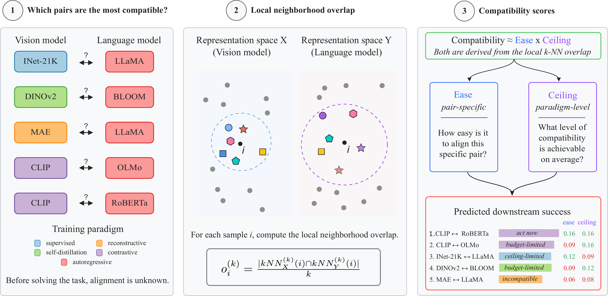

# To Align or Not To Align: Check Your COMPASS Before You Train

[](https://neurips.cc/Conferences/2026)
[](https://arxiv.org/abs/2610.18638)
[](https://brbiclab.epfl.ch/projects/compass/)

**[Fabian Gröger*](https://fabiangroeger96.github.io/)** · **[Petar Damjanović*](https://www.linkedin.com/in/petard712/)** · **[Maria Brbić](https://brbiclab.epfl.ch/team/)**

---

## Overview



Aligning a vision encoder with a language model, or merging two fine-tuned checkpoints, is expensive, and whether a pair works is usually known only afterwards.
**COMPASS** (**COMP**atibility **AS**sessment **S**core) predicts it beforehand from forward passes over a small probe set.
It scores each pair on two axes, both based on the mutual *k*-NN overlap of the two representation spaces:

- **Ease** (pair-specific): how much the two models agree before training.
- **Ceiling** (paradigm-level): how much agreement their training paradigms allow.

COMPASS ranks pairs by ease × ceiling. Splitting each axis at its median puts every pair in one of four regimes:

| | high ceiling | low ceiling |
|---|---|---|
| **high ease** | **act now**: the strongest candidates | **ceiling-limited**: switch to a paradigm closer to the target |
| **low ease** | **budget-limited**: more data, more training, or a stronger partner | **incompatible**: deprioritize |

On 72 vision-language pairs, the ranking reaches a Pearson correlation of 0.90 with Flickr30k and 0.91 with COCO image-to-text R@1 after alignment.
On 392 task-arithmetic merges, it reaches 0.70 with mean retention.

## Installation

### Requirements

- Python 3.10+
- PyTorch 2.6+

### Setup

1. Clone the repository:
```bash
git clone https://github.com/mlbio-epfl/COMPASS.git
cd COMPASS
```

2. Install the package:
```bash
pip install -e .                # ".[examples]" for the notebook
```

## Quick Start

### 1. Alignment from the command line

Rank every vision × text pair on the 1024 WIT image-caption pairs of the [Platonic Representation Hypothesis](https://github.com/minyoungg/platonic-rep):
```bash
compass align \
    --vision vit_base_patch16_clip_224.laion2b vit_base_patch14_dinov2.lvd142m vit_base_patch16_224.mae \
    --text allenai/OLMo-1B-hf bigscience/bloomz-560m sentence-transformers/all-roberta-large-v1 \
    --cache cache/ --out scores.csv
```

Vision models are [timm](https://github.com/huggingface/pytorch-image-models) names and text models are Hugging Face names.
The ceiling of a vision model is its mean overlap with the given text models, so more and more varied text models give a better estimate.

### 2. Alignment in Python

```python
import compass

images, captions = compass.load_wit_probe()
vision = {m: compass.extract_vision_features(m, images) for m in vision_models}   # [N, layers, dim]
text = {m: compass.extract_text_features(m, captions) for m in text_models}

ranking = compass.score_alignment(vision, text)   # text_library={...} sets a separate ceiling library
print(ranking[["rank", "vision", "text", "ease", "ceiling", "compass", "regime"]])
```

### 3. Merging in Python

```python
import compass

probe = [...]  # about 2k PIL images from one of the tasks being merged

feats, base = {}, {}
for name, (arch, ckpt) in checkpoints.items():   # fine-tuned checkpoints
    model = compass.load_vision_model(arch, checkpoint=ckpt)
    feats[name] = compass.extract_vision_features(model, probe, layers="last")
    base[name] = arch

# ceiling of a base model: 1 - its mean overlap with a library of pretrained vision models
images, _ = compass.load_wit_probe()
library = {m: compass.extract_vision_features(m, images) for m in reference_vision_models}
ceilings = {b: compass.ceiling_merging(compass.extract_vision_features(b, images), library, base_name=b)
            for b in set(base.values())}

ranking = compass.score_merging(feats, base, ceilings)
```

### 4. Overlap

```python
res = compass.mutual_knn(feats_a, feats_b, k=10)   # [N, D] or [N, L, D]
res.score        # calibrated overlap in [0, 1]
res.raw          # raw mutual k-NN overlap, max over layer pairs
res.best_layers  # the layer pair with the maximum

compass.per_sample_overlap(a, b, k=10)              # per-sample o_i, shape [N]
```

COMPASS calibrates overlaps as in the [Aristotelian Representation Hypothesis](https://github.com/mlbio-epfl/Aristotelian) (the same rule as [`calibrated-similarity`](https://pypi.org/project/calibrated-similarity/)): it shuffles the sample order 200 times and rescales the observed overlap O against the 95th percentile τ of the shuffled overlaps, as (O − τ) / (1 − τ) clipped at 0.
Pass `calibrate=False` for the raw overlap, which the merging ease uses.

[`examples/alignment.ipynb`](examples/alignment.ipynb) runs the full alignment workflow, including the phase diagram.

## Paper Settings

The defaults follow the paper:

| | Alignment | Merging |
|---|---|---|
| Probe | WIT, 1024 image-caption pairs | 2048 images from one of the tasks (MNIST) |
| Features | every block (vision, CLS token) and hidden state (text, mean over tokens), max over layer pairs | final layer, CLS token |
| Ease | calibrated overlap | raw overlap |
| Ceiling | mean calibrated overlap with a library of text encoders | 1 − mean calibrated overlap with a library of pretrained vision models |
| Overlap | *k* = 10, 200 permutations, α = 0.05 | *k* = 10 |

## Repository Structure

```
├── compass/
│   ├── overlap.py           # mutual k-NN overlap and its calibration
│   ├── features.py          # probe features of timm vision and Hugging Face text models
│   ├── scores.py            # ease, ceiling, ranking and regimes
│   ├── data.py              # WIT probe set
│   └── cli.py               # `compass align`
├── examples/
│   └── alignment.ipynb      # alignment ranking and phase diagram
├── assets/                  # README figure
└── tests/
```

## Citation

If you find this work useful, please cite:

```bibtex
@inproceedings{groger2026compass,
  title     = {To Align or Not To Align: Check Your {COMPASS} Before You Train},
  author    = {Gr{\"o}ger, Fabian and Damjanovi{\'c}, Petar and Brbi{\'c}, Maria},
  booktitle = {Advances in Neural Information Processing Systems (NeurIPS)},
  year      = {2026},
}
```

## License

MIT License - see [LICENSE](LICENSE) for details.
